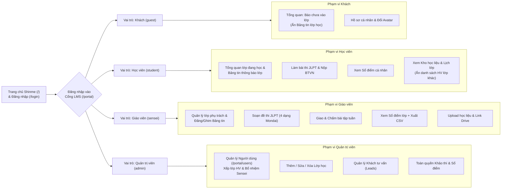
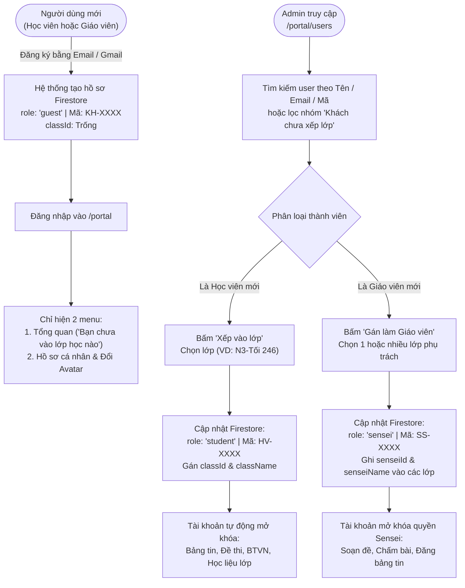
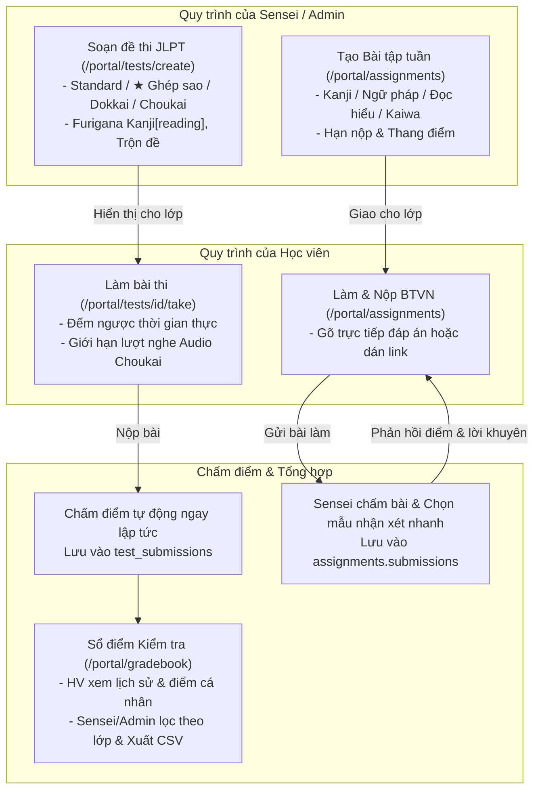
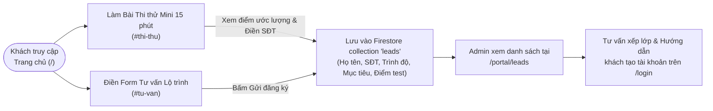

# Sơ đồ Luồng Chức năng & Nghiệp vụ (Functional Graph) — Shinme (`shinme-jp`)

Tài liệu trực quan hóa toàn bộ cấu trúc chức năng, phân quyền người dùng và các luồng nghiệp vụ chính trong hệ thống **Shinme LMS**.

---

## 1. Bản đồ Phân hệ & Phân quyền Chức năng theo Vai trò

---

## 2. Luồng Vòng đời Tài khoản: Đăng ký Khách → Xếp lớp / Bổ nhiệm Giáo viên

---

## 3. Luồng Khảo thí JLPT, Bài tập & Sổ điểm

---

## 4. Luồng Tuyển sinh & Chăm sóc Khách hàng (Landing Page → Leads)

