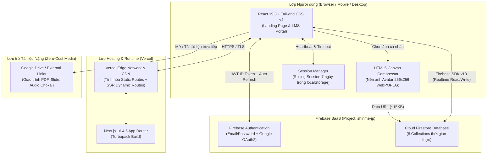
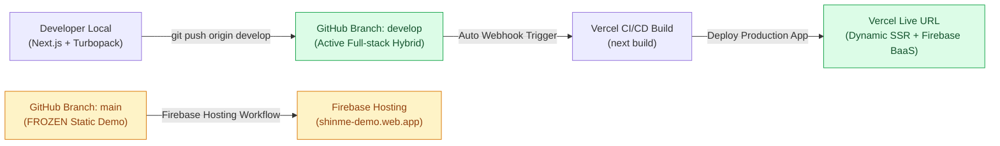
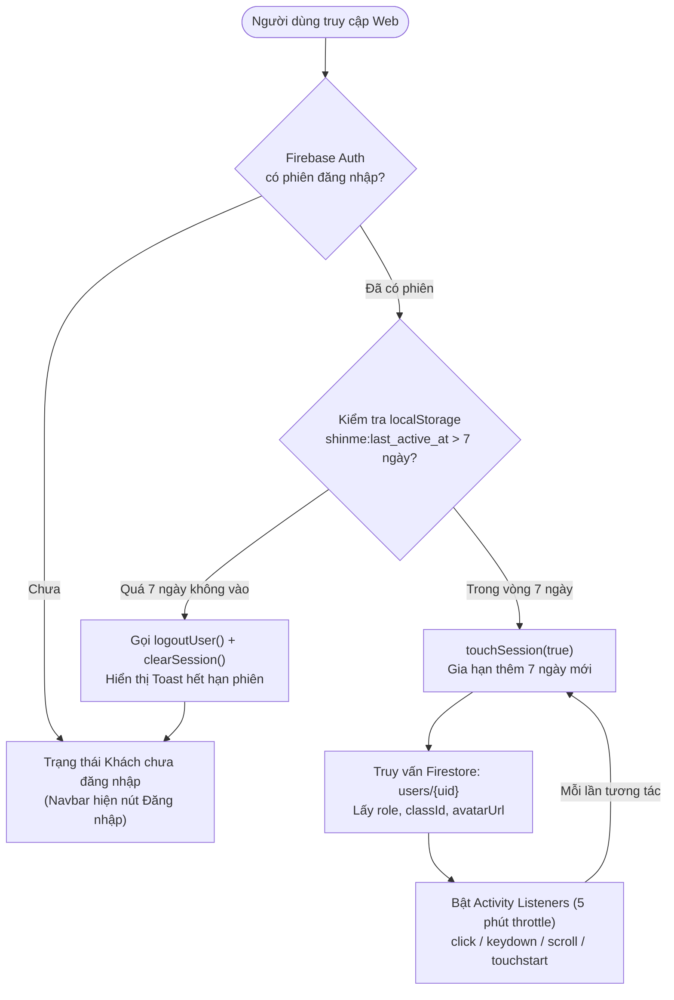
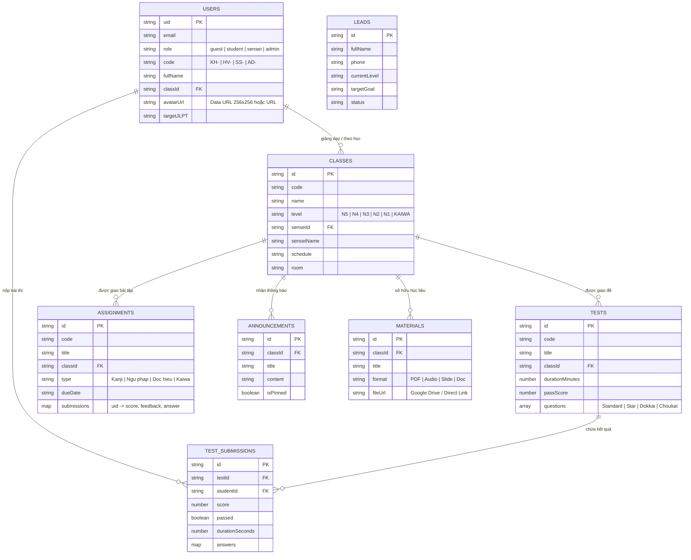

# Kiến trúc Hạ tầng Hệ thống (Infrastructure Graph) — Shinme (`shinme-jp`)

Tài liệu mô tả kiến trúc hạ tầng triển khai, luồng xác thực, cơ chế lưu trữ và quy trình CI/CD hiện tại của dự án **Shinme Japanese Center**.

---

## 1. Sơ đồ Hạ tầng Tổng thể (Full-stack Hybrid Architecture)

---

## 2. Sơ đồ Quy trình Nhánh Git & CI/CD Deployment

> [!IMPORTANT]
> Nhánh `main` được đóng băng riêng cho bản demo tĩnh trên Firebase Hosting (`shinme-demo.web.app`). Mọi tính năng mới, dữ liệu thật và cập nhật hệ thống đều đi qua nhánh **`develop`** và được Vercel tự động build/deploy.

---

## 3. Sơ đồ Cơ chế Xác thực & Phiên trượt 7 ngày (Rolling Session)

---

## 4. Sơ đồ Kiến trúc Dữ liệu & Lưu trữ Media

