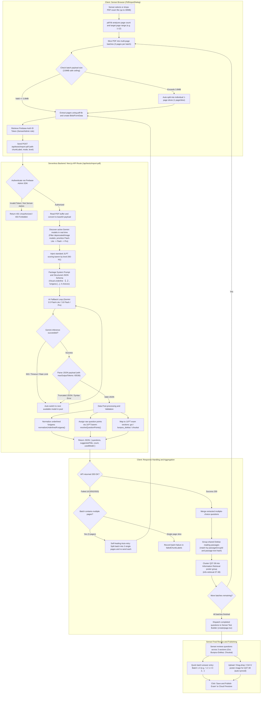

# Sơ đồ Kiến trúc & Luồng Xử lý: AI PDF Exam Importer (Shinme JLPT)

Tài liệu này mô tả chi tiết toàn trình quy trình số hóa và trích xuất câu hỏi từ file PDF đề thi tiếng Nhật (JLPT) vào hệ thống Shinme LMS (`shinme-jp`).

---

## 1. Sơ đồ Luồng Tổng quan (End-to-End Flowchart)

---

## 2. Chi tiết các Thành phần Kỹ thuật (Technical Breakdown)

### 2.1. Phía Client (`src/components/portal/pdf-import-dialog.tsx`)
- **Tách trang trên RAM (`pdf-lib`)**: Cắt file PDF gốc thành từng file PDF độc lập gồm 3 trang (`PAGES_PER_CHUNK = 3`).
- **Kiểm soát dung lượng an toàn (`MAX_CHUNK_UPLOAD_BYTES = 3.8MB`)**: Vercel Serverless Function giới hạn kích thước request body tối đa là 4.5MB. Bất kỳ cụm 3 trang nào có dung lượng vượt quá 3.8MB sẽ tự động được xé nhỏ thành từng trang đơn trước khi gửi đi.
- **Cơ chế Tự động phục hồi lỗi (Self-healing Auto-retry)**: Nếu cụm 3 trang bị lỗi đường truyền hoặc timeout, Client lập tức tách lẻ thành `[singlePageIdx]` và thử bóc lại từng trang độc lập, hạn chế tối đa việc bỏ sót câu hỏi.
- **Duy trì ngữ cảnh bài đọc (`passageTextToGroupId`)**: Lưu hash/nội dung bài đọc trên Client để nhận diện các câu hỏi chung 1 bài văn bản Đọc hiểu dài bị ngắt giữa 2 cụm trang khác nhau.
- **Tự động gom nhóm câu 37–38**: Tự động gán `passageGroupId: "info-retrieval-37-38"` cho câu 37 và 38 (dạng bài Tìm kiếm thông tin 情報検索).

### 2.2. Phía Server (`src/app/api/tests/import-pdf/route.ts`)
- **Bảo mật**: Xác thực Firebase Admin Token của người dùng, bắt buộc role `sensei` hoặc `admin`.
- **Dynamic Gemini Model Pool**:
  - Tự động gọi API `ai.models.list()` để phát hiện các model đang hoạt động theo thời gian thực (cache 10 phút).
  - Ưu tiên theo thứ tự: `gemini-3.5-flash-lite` -> `gemini-3.8-flash` -> `Gemini Pro Pool`.
  - Nếu gặp lỗi `503 Service Unavailable`, tự động chuyển sang model tiếp theo trong danh sách.
- **Chống tràn Output Token**: Thiết lập `maxOutputTokens: 65536`.
- **An toàn khi Parse JSON**: Đặt bước `JSON.parse()` bên trong vòng lặp fallback model. Nếu model trả về JSON lỗi hoặc bị cắt cụt, hệ thống lập tức thử lại với model kế tiếp.
- **Hậu xử lý dữ liệu chuẩn Nhật**:
  - `normalizeUnderlinedFurigana`: Đưa furigana vào trong thẻ gạch chân `【毎日[まいにち]】` thay vì nằm ngoài `【毎日】[まいにち]`.
  - `resolveQuestionPoints`: Tra cứu barem điểm chuẩn từ `src/lib/jlpt-barem.ts` và gán điểm thô chính xác theo từng Mondai.
  - Phân vùng thi JLPT chuẩn: `goi`, `bunpou_dokkai`, `choukai`.

### 2.3. Hỗ trợ thao tác của Sensei (`src/app/portal/tests/create/page.tsx`)
- **Đáp án chuẩn 1–4**: Thay thế toàn bộ hiển thị ABCD thành 1, 2, 3, 4 theo chuẩn đề JLPT Nhật Bản.
- **Batch Answer Key (`src/components/portal/batch-answer-dialog.tsx`)**: Cho phép Sensei copy-paste chuỗi đáp án (VD: `1 2 1 4 3 2...` hoặc `121432`) để tự động gán đáp án cho hàng chục câu hỏi chỉ trong 1 giây.
- **Đồng bộ ảnh Poster Đọc hiểu (Q37–38)**: Sensei chỉ cần dán (Ctrl+V) hoặc chọn ảnh áp phích 1 lần ở câu 37 (hoặc 38), hệ thống tự đồng bộ ảnh cho cả 2 câu.

---

## 3. Các File Mã Nguồn Liên Quan

1. [pdf-import-dialog.tsx](file:///d:/Projects/shinme-jp/src/components/portal/pdf-import-dialog.tsx) — Hộp thoại tải và điều phối bóc tách PDF tại Client.
2. [route.ts (import-pdf)](file:///d:/Projects/shinme-jp/src/app/api/tests/import-pdf/route.ts) — Backend route xử lý AI Gemini và chuẩn hóa dữ liệu câu hỏi.
3. [batch-answer-dialog.tsx](file:///d:/Projects/shinme-jp/src/components/portal/batch-answer-dialog.tsx) — Hộp thoại nhập đáp án nhanh hàng loạt (Batch 1–4).
4. [jlpt-barem.ts](file:///d:/Projects/shinme-jp/src/lib/jlpt-barem.ts) — Barem quy chuẩn tính điểm câu hỏi thô theo JLPT.
5. [furigana.ts](file:///d:/Projects/shinme-jp/src/lib/furigana.ts) — Trình xử lý cú pháp Furigana và chữ gạch chân.
6. [create/page.tsx](file:///d:/Projects/shinme-jp/src/app/portal/tests/create/page.tsx) — Trình biên soạn và xuất bản đề thi của Sensei.
